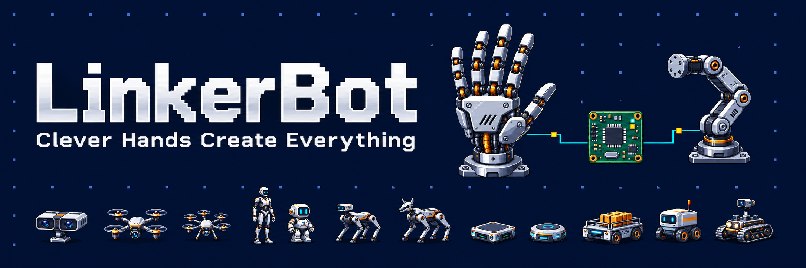

  

  Open-source SDKs, communication libraries, teleoperation tools, and simulation projects for LinkerBot hands and arms.

  <a href="https://linkerbot.cn">Website</a> ·
  <a href="https://github.com/linker-bot/SDK">SDK directory</a> ·
  <a href="https://github.com/linker-bot/.github/blob/main/profile/README.zh-CN.md">中文</a>

## Start building

Use the [SDK directory](https://github.com/linker-bot/SDK) to choose a maintained project and check migration guidance for older SDKs. Install and build software from the individual repositories.

- **Hands:** use the [C++ SDK](https://github.com/linker-bot/linkerbot-hand-cpp-sdk) or [Python SDK](https://github.com/linker-bot/linkerbot-hand-python-sdk), or the [Hand ROS 2 SDK](https://github.com/linker-bot/linkerbot-hand-ros2-sdk) for ROS topics and services.
- **Arms:** use the [Arm Python SDK](https://github.com/linker-bot/linkerbot-arm-python-sdk) or [Arm ROS 2 SDK](https://github.com/linker-bot/linkerbot-arm-ros2-sdk).
- **Communication:** use the [C++ transport library](https://github.com/linker-bot/linkerbot-transport-cpp) or [Python transport library](https://github.com/linker-bot/linkerbot-transport) for communication independently of device control APIs.
- **Simulation:** start with [linker-sim](https://github.com/linker-bot/linker-sim) and its repository documentation.

Check each project's supported models, firmware, adapters, operating systems, and installation instructions before running hardware examples.

## Explore the ecosystem

### Tools and teleoperation

- [linkerbot-hand-tools](https://github.com/linker-bot/linkerbot-hand-tools) — CLI/TUI and Web tools for hand control, telemetry, tactile visualization, and offline simulation.
- [linkerhand-telop-ros2](https://github.com/linker-bot/linkerhand-telop-ros2) — ROS 2 glove-to-hand motion retargeting.
- [linkerbot-teleop-arm](https://github.com/linker-bot/linkerbot-teleop-arm) — reads a dual-arm input device over SocketCAN, with a C++ core, CLI, and ROS 2 node. This is an input-device reader, not the arm motion-control SDK.

### Existing deployments

Earlier SDKs are retained for existing applications. Consult the [SDK directory and legacy migration guide](https://github.com/linker-bot/SDK/blob/main/MIGRATION.md) before changing SDKs. A successor is not necessarily a drop-in replacement; verify model and interface compatibility.

### Simulation and assets

- [linker-sim](https://github.com/linker-bot/linker-sim) — simulation project.
- [linker-sim-isaac](https://github.com/linker-bot/linker-sim-isaac) — Isaac simulation project.
- [linker-sim-viser](https://github.com/linker-bot/linker-sim-viser) — visualization project using Viser.
- [linker-sim-assets](https://github.com/linker-bot/linker-sim-assets) — robot descriptions and assets used by the simulation projects.

[Browse all repositories →](https://github.com/orgs/linker-bot/repositories)

## Build with us

Bug reports, documentation improvements, examples, and code contributions are welcome. Start with the project's README and our [contribution guide](https://github.com/linker-bot/.github/blob/main/CONTRIBUTING.md).

- **Questions and bugs:** use the relevant repository's Issues and [support guide](https://github.com/linker-bot/.github/blob/main/SUPPORT.md).
- **Security reports:** follow the [security policy](https://github.com/linker-bot/.github/blob/main/SECURITY.md).
- **New projects:** use our [repository standards and reference layouts](https://github.com/linker-bot/.github#repository-standards-and-templates).

Please follow our [code of conduct](https://github.com/linker-bot/.github/blob/main/CODE_OF_CONDUCT.md).
